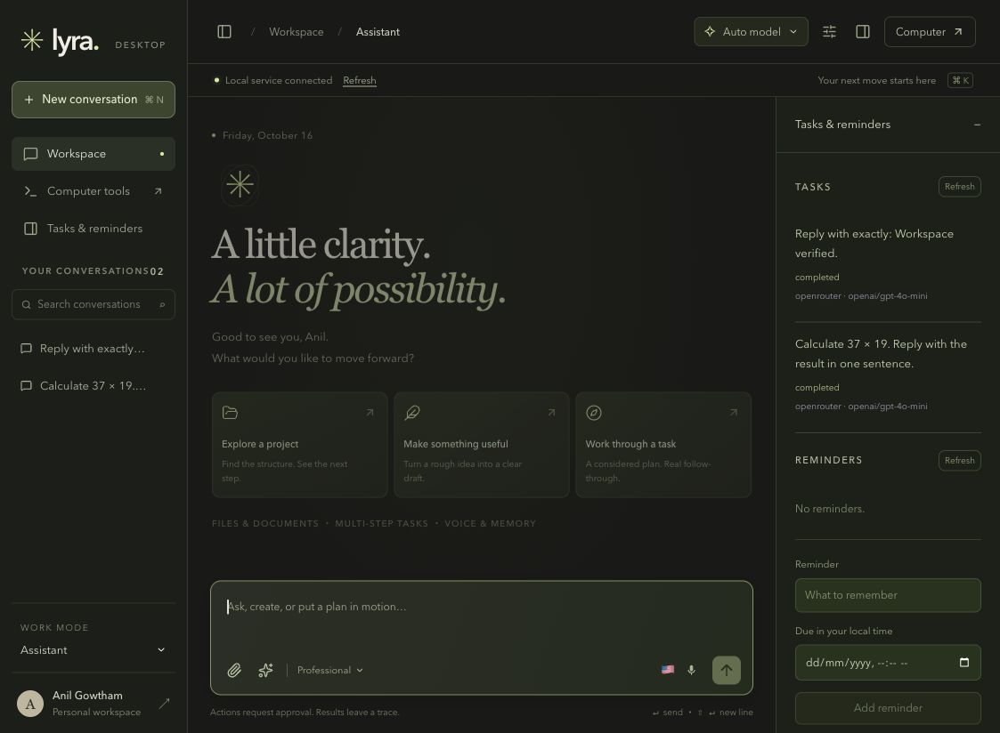

# Lyra — Personal Desktop Assistant

A macOS assistant that connects a React/Electron workspace to a local FastAPI backend. Chat, document retrieval, voice input, persistent tasks, and approval-controlled tools share one task lifecycle.



## What it does

- Keeps conversations, memories, tasks, and reminders in SQLite.
- Requests approval before file writes, terminal commands, and desktop actions; records tool results and supports cancellation and restart recovery.
- Searches local documents and Git history within configured workspace roots, with credential exclusions, bounded reads, and file/line citations.
- Offers voice transcription with an explicitly installed local model or a configured provider.
- Connects to multiple model providers and an optional local Ollama service.

## Stack

React · Electron · Vite · Python · FastAPI · SQLite

## Run locally

Use Node.js 22+ and Python 3.11. macOS is required for the native desktop workflows.

```sh
npm ci
python3 -m venv lyra-backend/.venv
lyra-backend/.venv/bin/python -m pip install -r lyra-backend/requirements.txt
cp .env.example .env
```

Configure your own provider credentials in `.env`, or configure Ollama. Set `LYRA_WORKSPACE_ROOTS` to the directories you intend to make available. For the optional Claude Code tool, set `CLAUDE_BINARY_PATH` to your installed executable.

```sh
npm run build
npm start
```

For a browser preview, run `npm run dev`; start the backend separately with `lyra-backend/.venv/bin/python lyra-backend/main.py` when backend features are needed.

## Verification

```sh
npm test
npm run build
```

Verified on **18 November 2026** with the existing local dependencies: **200 tests passed** (56 frontend and 144 backend), including 27 document/Git retrieval regressions. The production web build passed. Tests use synthetic files, temporary databases, and mocked providers; live model availability and physical microphone/macOS permissions require separate checks. A fresh dependency installation was not verified in the restricted execution environment.

## Design and limitations

The backend is bound to loopback and authenticates requests. File operations and retrieval enforce configured roots. Approved shell commands execute on the host: the working-directory policy is not an operating-system sandbox. Reminders fire while the backend is running.

The macOS packaging workflow produces a locally signed application. A public notarized release is future work. This repository contains source, not a prebuilt installer, downloaded models, API keys, or saved conversations.

- [Architecture](docs/architecture.md)
- [User and packaging guide](docs/user-guide.md)
- [Implemented features and remaining work](ROADMAP.md)

## Repository map

| Path | Purpose |
| --- | --- |
| `src/` | React workspace, task controls, voice UI, backend client |
| `electron/`, `electron.js`, `preload.js` | Desktop lifecycle and backend supervision |
| `lyra-backend/core/` | Tasks, execution policy, retrieval, persistence |
| `lyra-backend/tools/` | File, shell, search, and desktop tools |
| `scripts/tests/`, `lyra-backend/tests/` | Frontend/lifecycle and backend regression tests |
| `packaging/`, `scripts/` | Build, installation, and verification helpers |
