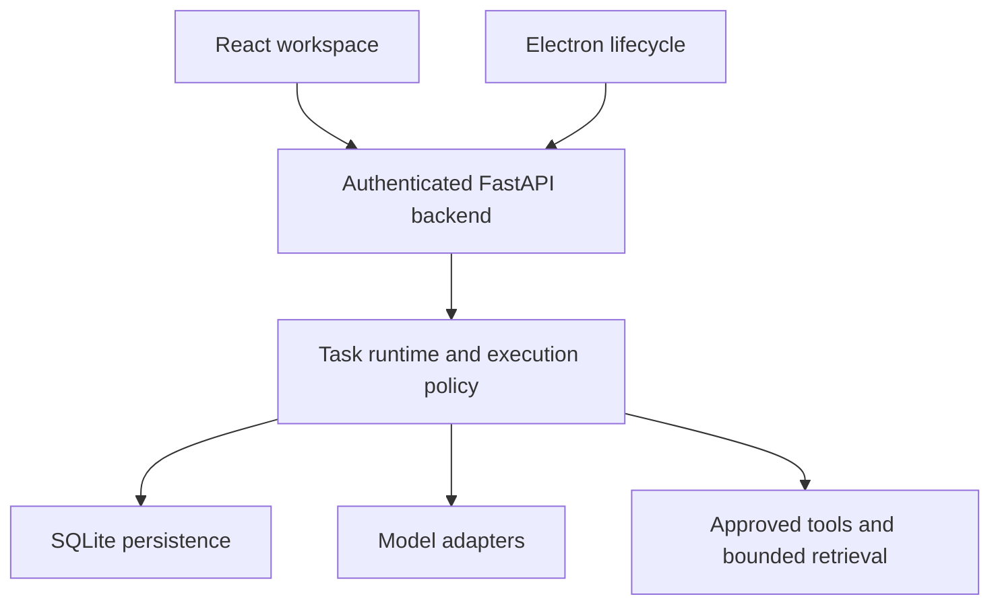

# Lyra architecture

Requests become durable tasks. The runtime records progress, pauses for required approvals, accepts cancellation, and preserves tool receipts. Conversation and memory persistence use SQLite. The renderer cannot redirect backend credentials to arbitrary remote services.

Document retrieval uses keyword/path relevance rather than vector embeddings. It rejects roots outside the configured workspace, skips credential paths and symbolic links, and caps scan volume. Git history retrieval disables external helpers and bounds subprocess output and lifetime.

Cloud reasoning and cloud transcription send the explicitly selected context or audio to the configured provider. Configure local model paths and providers according to your intended data handling. Shell approval authorizes a host process; it does not create an OS sandbox.
